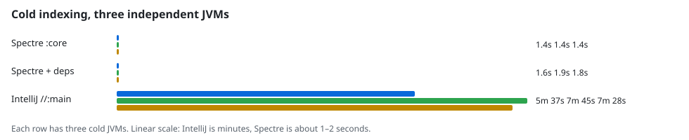
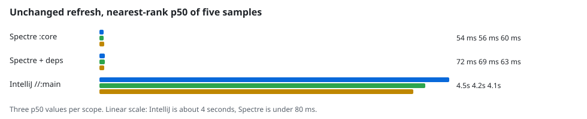

[](https://github.com/rock3r/indexino/actions/workflows/check.yml)

Indexino is a standalone Kotlin CLI and embeddable library that builds a **persistent** local code index in a
user-local content-addressed cache (never under the target worktree) for agent audit tools.
Detekt-independent, Bazel-first (Gradle secondary), and ships as a fat compatibility JAR with no
target-repo build coupling. A separate R8-shrunk JAR is the internal native-distribution input.

**selection-context** is the first application plugin: precomputed SelectionContainer /
DisableSelection facts at composable call sites for Compose/Jewel UI audits.

The core index also extracts Kotlin and Java declarations/references plus Android XML resources.
Java uses the JDK compiler tree API, Kotlin uses embedded PSI, and XML uses secure JDK StAX
parsing; no language-server or parser daemon is required.

> **Experimental and unsupported** — Indexino is a personal experiment. Do not use it for
> production or important work. The project makes no commitment to maintenance, security fixes,
> future releases, stability, compatibility, or fitness for any use. It may change or stop without
> notice. The published 0.x artifacts have compatibility checks; explicitly experimental APIs may
> change in a minor release. CLI and storage contracts remain pre-release.

Licensed under the [Unenshittifiable License (UEL) v1.0](https://uelicense.eu/) — see
[LICENSE](LICENSE).

## Quick start

Build the fat JAR:

```bash
./gradlew shadowJar
# → build/libs/indexino-0.3.0-SNAPSHOT-all.jar
```

Build and verify the internal R8 native-packaging input:

```bash
./gradlew shrunkCliJar verifyShrunkCli
# → build/libs/indexino-0.3.0-SNAPSHOT-shrunk.jar
```

Run via Gradle during development, or invoke the JAR directly:

```bash
JAR=build/libs/indexino-0.3.0-SNAPSHOT-all.jar

# Build or refresh the index for a Bazel target
java -jar "$JAR" index \
  --project /path/to/monorepo \
  --bazel-target //plugins/foo/ui:ui \
  --applications dev.sebastiano.selection-context

# Query precomputed selection-context facts
java -jar "$JAR" query \
  --project /path/to/monorepo \
  --application dev.sebastiano.selection-context \
  --preset interactive-in-selection \
  --format jsonl

# Language-neutral symbol and reference lookups
java -jar "$JAR" find-symbol --project /path/to/repo --name Panel
java -jar "$JAR" find-references --project /path/to/repo --symbol 'sample.Panel#render'

# Android XML resource lookup
java -jar "$JAR" resolve-resource --project /path/to/repo --type string --name title
```

Equivalent Gradle invocations:

```bash
./gradlew run --args="index --project /path/to/monorepo --bazel-target //pkg:ui --applications dev.sebastiano.selection-context"
./gradlew run --args="query --project /path/to/monorepo --application dev.sebastiano.selection-context --preset interactive-in-selection --format jsonl"
```

Run tests:

```bash
./gradlew check
```

Build and verify a native distribution on its matching host:

```bash
./gradlew verifyNativeDistributionLinuxX64 sha256NativeDistributionLinuxX64
# macOS arm64 and Windows x64 use the corresponding MacArm64 / WindowsX64 suffix.
```

The resulting ZIP and `.sha256` file are under `build/distributions/`. Native packages bundle JBR
25 and the application, but still expect repository tools such as Git and the selected Bazel or
Gradle tooling on `PATH`. See [docs/DISTRIBUTIONS.md](docs/DISTRIBUTIONS.md) for installation,
supported baselines, AOT fallback, and current pre-release restrictions.

## Maven publication

The embedded API is published as a compatibility-gated 0.x release train. Use the BOM to keep the
facade, model, plugin SPI, and selection-context plugin aligned:

```kotlin
dependencies {
    implementation(platform("dev.sebastiano.indexino:indexino-bom:<version>"))
    implementation("dev.sebastiano.indexino:indexino")
    implementation("dev.sebastiano.indexino:indexino-selection-context")
}
```

`indexino-model`, `indexino`, `indexino-plugin-api`, and `indexino-selection-context` are thin
artifacts. See [docs/API-STABILITY.md](docs/API-STABILITY.md) for the supported packages,
experimental-status policy, and compatibility gates.

The Shadow `*-all.jar` remains the standalone distribution for direct `java -jar` use. The
`*-shrunk.jar` is not a Maven artifact. See [docs/PUBLISHING.md](docs/PUBLISHING.md) for local
publication verification and the release flow.

## Docs

| Doc | Topic |
|-----|--------|
| [docs/USER-GUIDE.md](docs/USER-GUIDE.md) | Install, authenticate, index, and query |
| [docs/CLI.md](docs/CLI.md) | Commands, flags, JSONL schema |
| [docs/ARCHITECTURE.md](docs/ARCHITECTURE.md) | Layers |
| [docs/INDEX-STORAGE.md](docs/INDEX-STORAGE.md) | User-local cache + keys |
| [docs/API-STABILITY.md](docs/API-STABILITY.md) | Public API boundary and compatibility gates |
| [docs/PLUGIN-AUTHORING.md](docs/PLUGIN-AUTHORING.md) | Compiled plugin ABI and manifest contract |
| [docs/PUBLISHING.md](docs/PUBLISHING.md) | Maven coordinates and release flow |
| [docs/DISTRIBUTIONS.md](docs/DISTRIBUTIONS.md) | Native installation, support, and release gates |
| [AGENTS.md](AGENTS.md) | Agent rules |

## Contributing

After the initial GitHub import, all changes go through **pull request → CI babysit →
squash merge** cycles. See [CONTRIBUTING.md](CONTRIBUTING.md) for the full workflow,
local checks, and agent conventions.

## Measured public corpora

These numbers are from one serial run of the pinned public acceptance harness on 11 Nov 2026,
against commit `f2eaf99fd2f3223926be21b71adb8859620e63d9`. The pins and method are in
[docs/PUBLIC-ACCEPTANCE.md](docs/PUBLIC-ACCEPTANCE.md) and
[scripts/public-acceptance/corpora.json](scripts/public-acceptance/corpora.json). Exact inventory
equality, query assertions, and verified cleanup passed. Timings are report-only: the host was
shared, the OS page cache was uncontrolled, and the IntelliJ job reached its 16 GiB accounted-memory
cap without an observed OOM kill. They are not an SLA and not an IntelliJ IDEA comparison.

| Corpus | Pinned scope | Captured inputs |
|---|---|---|
| [Spectre](https://github.com/rock3r/spectre) `9ccbcfc` | `:core`, target only | 47 |
| Spectre, syntactic dependency whitelist | `:core` plus reviewed dependency roots | 68 |
| [IntelliJ Community](https://github.com/JetBrains/intellij-community) `9b85e06` | `//:main`, dependencies required | 65,149 |

IntelliJ exclusions, counted separately and not dropped from the denominator: 2,285 external labels,
1 generated label, 5,221 unsupported paths, and 1,015 directories. Each scope ran three cold JVMs.
All three repeats published the same generation. A separate instrumented repeat showed core producer
work on the cold refresh and none on five unchanged refreshes.





An exact-symbol query against an already acquired snapshot, 100 samples after 10 warmups, had p95
below 0.22 ms on these scopes. Spectre queried `ComposeAutomator` and `AutomatorNode`. IntelliJ
queried `ApplicationManager`, with per-repeat p95 of 0.139, 0.159, and 0.166 ms. That excludes
process launch, snapshot acquisition, and daemon protocol overhead. Reconnecting an in-process
client and checking the published generation took 12–19 ms on IntelliJ and 26–43 ms on Spectre.
That is not a fresh process.

The invented `retrieval-v1` fixture passed its syntactic cases exactly, including the held-out
alias case, on both manual and watcher lanes. Two same-arity semantic cases remain precision 0.5
and recall 1.0. They are labelled compiler-resolution gaps, not syntactic failures. See
[docs/RETRIEVAL-FIXTURES.md](docs/RETRIEVAL-FIXTURES.md).

These measurements do not include save-to-query watcher latency. A cold IntelliJ index is minutes,
not subsecond, and an unchanged IntelliJ refresh is several seconds. macOS and Windows cannot run
this corpus lane: the harness requires Linux cgroup v2 containment for a detached Bazel server.

## Status

Core **C0–C1** and application **A1–A3** milestones implemented. See
[docs/CLI.md](docs/CLI.md) for full command reference.
